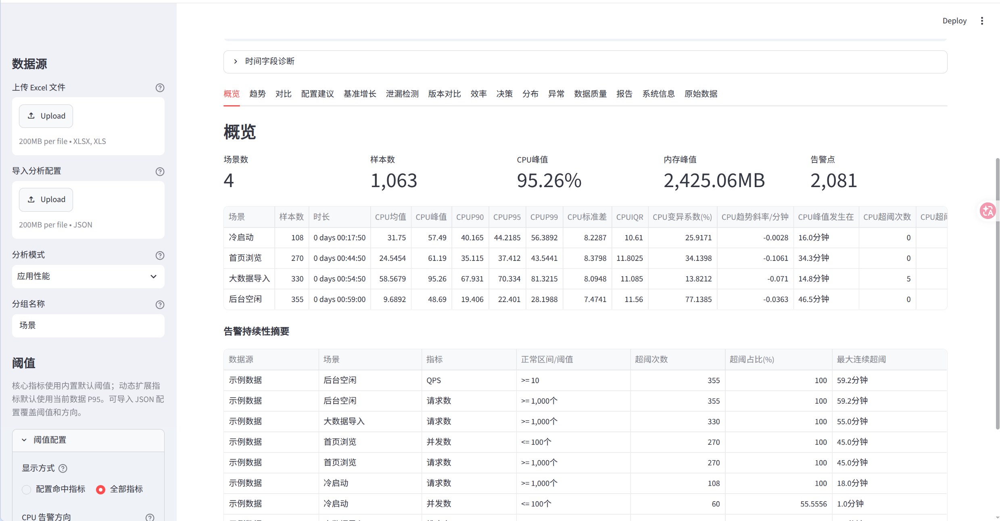
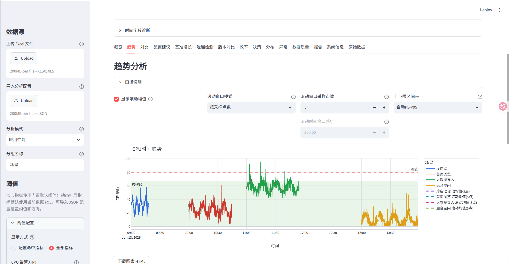
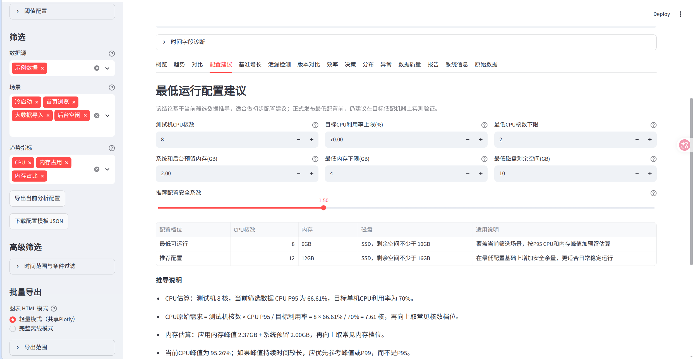
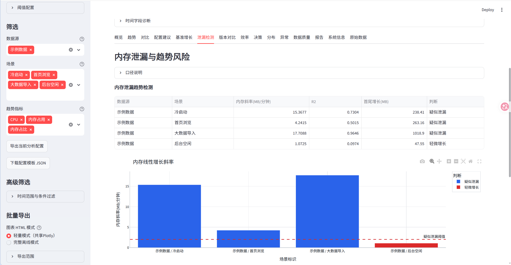
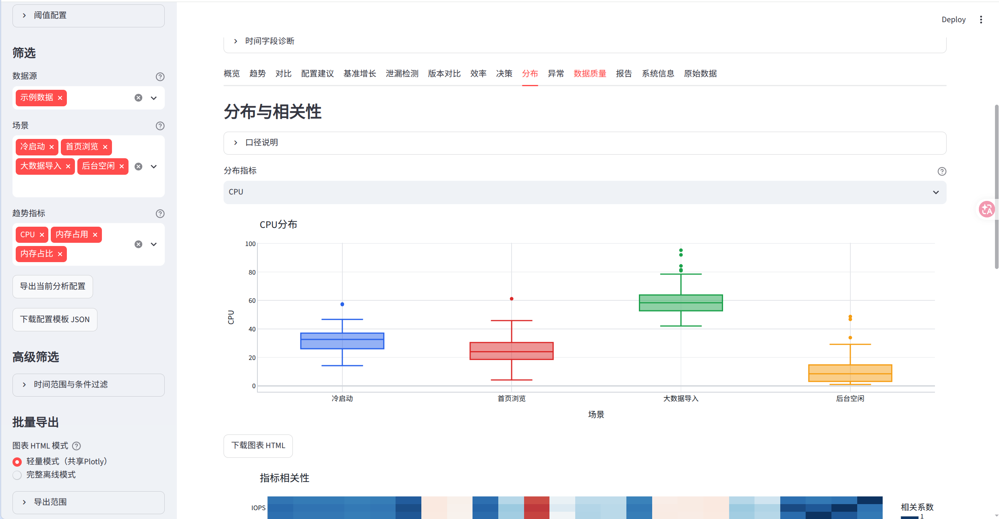
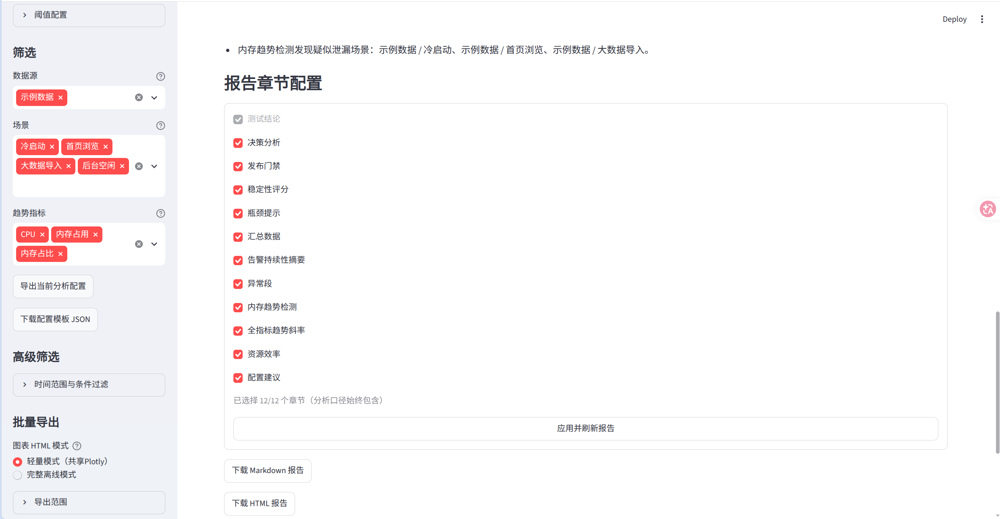

# Application Resource Consumption Analysis

English | [简体中文](README.md)

A Streamlit page for analyzing application resource consumption Excel data: cross-scenario comparison, trend observation, threshold anomalies, memory leak detection, version regression detection, resource efficiency, capacity estimation, and automatic test reports.

- Convention: the first sheet of the workbook holds system information (display only); every other sheet is one test scenario, and the sheet name is the scenario name.
- Detailed analysis methods and metric definitions: [docs/analysis-methodology.md](docs/analysis-methodology.md) (Chinese).
- Code structure: [docs/code-map.md](docs/code-map.md) (Chinese).

## Table of Contents

- [Quick Start](#quick-start)
- [UI Preview](#ui-preview)
- [Real Data Collection](#real-data-collection)
- [Use Cases](#use-cases)
- [Excel Data Structure](#excel-data-structure)
- [Analysis Modes](#analysis-modes)
- [Pages](#pages)
- [Sidebar Configuration](#sidebar-configuration)
- [Analysis Config File](#analysis-config-file)
- [Metric Definitions and Core Algorithms](#metric-definitions-and-core-algorithms)
- [CPU Core Estimation](#cpu-core-estimation)
- [Sample Data](#sample-data)
- [Project Structure and Development](#project-structure-and-development)

## Quick Start

```bash
# 1. Install dependencies
python3 -m pip install -r requirements.txt

# 1.5 Collect real data (optional; sample data is bundled; the collector needs psutil)
# python3 collect_performance_data.py --system --interval 5 --duration 10

# 2. Generate sample data for debugging (optional; skip if data/sample_resource_consumption.xlsx already exists)
python3 generate_sample_data.py

# 3. Start the page
streamlit run app.py
```

Then open `http://localhost:8501`.

- Without an upload, the app reads `data/sample_resource_consumption.xlsx`; once you upload files, the uploaded files take precedence.
- Multiple Excel files can be uploaded at once; each file name becomes a "data source" used for version comparison and multi-batch comparison.

Run the tests:

```bash
python3 -m pytest tests/ -q
```

## UI Preview

All screenshots below are taken from the sample data (`data/sample_resource_consumption.xlsx`) in "Application performance" mode and cover the main analysis modules.

**Overview**: scenario count, sample count, CPU/memory peaks and total alert points, plus per-scenario CPU statistics (mean/peak/P90/P95/P99/volatility/trend slope) and the alert persistence summary.



**Trends**: overlaid metric curves for multiple scenarios with rolling mean, P5-P95 band and threshold line, making pressure windows easy to locate.



**Configuration recommendation**: derives the minimum runnable and recommended configuration from test machine cores, target CPU utilization ceiling, and memory/disk reserves, with the full derivation shown.



**Leak detection**: memory linear regression slope, R2, first-to-last growth and suspected-leak verdict, with a bar chart comparing growth rates across scenarios.



**Distribution**: box plots for within-scenario spread and outliers, with a metric correlation heatmap below.



**Report**: sections are selectable (12 sections in total) and exportable as Markdown / HTML / Word / PDF / ZIP in one click.



## Real Data Collection

The page only analyzes; the acquisition side uses `collect_performance_data.py` to write real samples into an Excel workbook this tool can upload directly (structure: see "Excel Data Structure").

### Quick start

```bash
# dependency (already in requirements.txt)
python3 -m pip install psutil

# 1. Whole machine for 10 minutes, one point every 5 seconds
python3 collect_performance_data.py --system --interval 5 --duration 10

# 2. A specific process (children aggregated too)
python3 collect_performance_data.py --name java --children --scenario "load-heavy"

# 3. Several scenarios into one workbook for cross-scenario comparison
python3 collect_performance_data.py --name MyApp --scenario "light" --output data/run1.xlsx
python3 collect_performance_data.py --name MyApp --scenario "heavy" --append --output data/run1.xlsx

# 4. Collect until Ctrl+C (--duration 0), autosave every 200 rows
python3 collect_performance_data.py --pid 12345 --duration 0 --flush-samples 200
```

Output defaults to `data/collected_performance.xlsx`: the 1st sheet is "system information" (app name / version / device / OS / CPU / memory / sampling interval / target), then one sheet per `--scenario`, and the sheet name is the scenario name — upload it as is.

### Collected columns and conventions

| Column | Source | Convention |
|---|---|---|
| `时间戳` (timestamp) | Local clock | `YYYY-MM-DD HH:MM:SS`, local time |
| `CPU%` | Process or machine | `--cpu-mode process` (default) = per-process share of **one core** (may exceed 100 on multi-thread); `--cpu-mode machine` = whole-machine utilization 0-100 |
| `内存占用（MB）` / `内存占用百分比` | Process memory | `--memory-mode rss` (resident) or `uss` (unique) |
| `系统总内存` | Whole machine | In MB, used to derive the memory percentage |
| `线程` / `句柄` | Process | Summed over the process tree; handles = open fds on Linux |
| `io` | Disk IO rate | Read+write combined MB/s, unit explained by the acquisition convention |
| `磁盘读(MB/s)` / `磁盘写(MB/s)` / `IOPS` | Process or machine | Per-process `/proc/<pid>/io` deltas when a process is targeted |
| `网络上行/下行(KB/s)` | Whole-machine NIC | System-level deltas; cannot be attributed per process |
| `进程数` / `上下文切换/秒` | Process tree / machine | Join trend and alert analysis as dynamic metrics |

> **Convention warning**: the CPU core estimation formula on the "Configuration recommendation" page requires `CPU%` to be whole-machine utilization (0-100). If you collect with the default per-process convention, collect a second run with `--cpu-mode machine` before applying the formula, otherwise a single-core share gets read as a whole-machine share and core demand is overestimated.

### Business fields (QPS / concurrency / response time)

Resource fields can be sampled externally; throughput and experience fields cannot. Have the system under test periodically emit a JSON / JSONL snapshot, then attach it during collection with `--metrics-file` and it is merged in under the standard field names:

```bash
python3 collect_performance_data.py --name MyApp --metrics-file /tmp/app_metrics.json
```

Snapshot keys are recognized through the same alias tables the page uses (`.jsonl` takes the last line, `.json` takes the object itself or the last array element):

```json
{
  "qps": 120.5,
  "concurrency": 80,
  "latency_ms": 235.8,
  "requests": 1000,
  "failed_requests": 3,
  "retry_count": 1,
  "heap_mb": 512
}
```

`qps`, `请求数` (request count), `并发数` (concurrency), `响应时间(ms)`, `错误数`, `FPS`, `GC*`, network and disk fields all accept Chinese, English and snake_case spellings; unmatched keys are ignored without affecting collection.

### Collection advice

- **Sampling interval**: keep it identical to the real collection tool (typically 5-30 s). The shorter the interval, the more meaningful the "Raw data" page and timestamp diagnostics; below 1 s the per-process CPU% jitters noticeably.
- **Scenario naming**: one sheet per scenario; a duplicate scenario name automatically gets a `-2` suffix and never overwrites the previous round (use `--overwrite-sheet` to replace it).
- **Process trees**: use `--name` + `--children` for multi-process / multi-worker services; `--pid` is more stable for a single service, and a process restart will not leak into a same-named process.
- **Long runs**: `--duration 0` collects until Ctrl+C, with `--flush-samples` persisting periodically so an interruption does not lose data; if the target exits mid-run, empty rows are kept to preserve the timeline.
- **Multi-machine / multi-batch**: write one file per run and upload them under different file names as "data sources" to drive version comparison and multi-batch comparison.

## Use Cases

- Resource comparison across light load, heavy load, idle, cold start, long-running and other scenarios
- Trend observation and threshold alerting for CPU, memory, threads, handles, IO
- Finding peaks, P95, P99 and other high-water marks and outliers
- Resource pressure differences and regression verdicts across versions / builds / test batches
- Deriving minimum runtime and recommended configuration from long-running resource data
- Debugging the analysis flow with sample data before real measurement data is available

## Excel Data Structure

The workbook is split by sheet:

| Sheet position | Meaning | Notes |
|---|---|---|
| 1st sheet | System information | Display only, not used in metric computation |
| 2nd and later | Scenario data | One scenario per sheet; the sheet name is the scenario name |

Scenario sheets are matched against core headers first (timestamp, CPU%, memory usage (MB), total system memory, memory usage percentage, threads, handles, io). Field names accept approximate Chinese and English variants, e.g. `CPU%`, `cpu`, `内存占用（MB）`, `memory`, `thread`, `线程` are all recognized; anything unrecognized can be added as an alias under "Custom field mapping" in the sidebar.

In "Application performance" mode, semantic extension fields are also recognized with priority: `QPS`, `TPS`, task count, concurrency, `response time (ms)`, error count, `FPS`, jank count, `GC count`, `GC time (ms)`, `heap memory (MB)`, network up/down (KB/s), request count, failed request count, retry count, disk read/write (MB/s), `IOPS`, `IO wait (ms)`. These fields feed trend, comparison, efficiency and decision analysis; any other numeric column automatically becomes a "dynamic extension metric" (e.g. `GPU%`, queue length).

Configuration recommendation uses only the semantically well-defined core metrics — CPU, memory, threads, handles, IO; business fields are mainly used for efficiency, experience and stability judgments.

## Analysis Modes

| Mode | Suitable data | Page characteristics |
|---|---|---|
| Application performance | Application resource consumption, load testing, version performance comparison | Auto-detects CPU, memory, IO, QPS, response time and other performance semantics; includes performance-specific pages such as configuration recommendation, efficiency and decision |
| Generic time series | Sensors, device measurements, experiment logs, quality inspection and other generic sampling data | Only the timestamp is mandatory; every other numeric column is treated as a metric. Keeps overview, trends, comparison, version comparison, distribution, alerts and report |

Generic time series mode reuses the same Excel structure; the group label can be configured in the sidebar as "device", "operating condition", "batch", "experiment group", etc.

Recommended field format:

| Field | Type | Example | Notes |
|---|---|---|---|
| Timestamp | Time | `2026-06-13 09:00:00` | Trend chart x-axis |
| CPU% | Number | `36.5` | CPU utilization |
| Memory usage (MB) | Number | `1024.8` | Memory used by the app |
| Total system memory | Number | `16384` | In MB, used to derive memory percentage |
| Memory usage percentage | Number | `6.25` | Derived from memory usage / total system memory when missing |
| Threads / handles | Number | `68` / `1200` | Thread and handle counts |
| io | Number | `3.4` | IO metric, unit defined by the collection tool |
| QPS / TPS | Number | `120.5` | Business throughput, used for per-unit resource cost |
| Concurrency | Number | `80` | Concurrent users, connections or tasks |
| Response time (ms) | Number | `235.8` | Response quality metric |
| FPS / jank count | Number | `58.2` / `1` | Client rendering experience |
| GC count / GC time (ms) / heap memory (MB) | Number | `3` / `45.6` / `512` | Runtime reclamation pressure |
| Network up/down (KB/s) | Number | `120` / `860` | Network throughput |
| Request count / failed requests / retries | Number | `1000` / `2` / `1` | Request stability |
| Disk read/write (MB/s) / IOPS / IO wait (ms) | Number | `20.5` / `8.2` / `320` / `12` | Disk pressure |
| Other numeric columns | Number | `GPU%`, queue length | Automatically treated as dynamic extension metrics |

## Pages

| Page | Purpose | Key capabilities |
|---|---|---|
| Overview | Quickly judge the overall state | Scenario count, sample count, CPU/memory peaks, alert points; per-scenario mean/peak/P90/P95/P99, volatility, trend slope, over-threshold count and ratio, longest consecutive over-threshold run |
| Trends | Observe metric curves over time | Multi-scenario overlay, threshold line, rolling mean, P5-P95 band, phase analysis (auto split into warm-up / stable / stress with boundaries) |
| Comparison | Cross-scenario comparison | Bar charts of mean/peak/P90/P95/P99/std/IQR/coefficient of variation/trend slope |
| Configuration recommendation | Derive runtime configuration | Input test machine cores, target CPU utilization, reserved memory, etc.; outputs minimum runnable and recommended configuration (CPU cores/memory/disk) |
| Baseline growth | Growth rate relative to a baseline | Choose baseline scenario and metric, compute per-scenario relative growth and plot it |
| Leak detection | Memory leaks and trend risk | Memory linear regression slope, R2, first-to-last growth, suspected-leak verdict; trend slopes for all metrics (CPU/threads/handles/IO/dynamic) |
| Version comparison | Multi-file version regression verdict | Compare data sources per scenario, choose the statistic, flag regression by growth-rate threshold; Mann-Whitney U + Cohen's d significance; version regression heatmap |
| Efficiency | Normalize resources to business load | CPU P95 per throughput, memory peak per concurrency, failure rate, etc.; throughput-resource scatter; minute-level normalization (bucketed instantaneous cost) |
| Decision | Turn metrics into test conclusions | Scenario risk rating, risk matrix, risk radar, release gate, stability score, bottleneck hints, capacity estimation and capacity curve |
| Distribution | Distribution and correlation | Box plots, correlation heatmap, control chart (mean/UCL/LCL) |
| Alerts | Threshold violation analysis | Anomaly segment summary and multi-metric linked chart, anomaly timeline, anomaly point detail, anomaly segment/point CSV and interactive HTML download |
| Report | Auto-generate the test report | Selectable sections; Markdown / HTML / Word / PDF / ZIP download; PDF is an archived summary with figures |
| Data quality | Data quality diagnostics | Time field diagnostics, time/metric quality summary, sampling jumps, non-numeric column hints |
| System info | Display the first sheet | App name, version, test device, system memory, sampling interval, etc. (not used in computation) |
| Raw data | Inspect mapped data | Sampling interval summary/distribution/timeline, export the current filtered CSV |

## Sidebar Configuration

| Configuration | Notes |
|---|---|
| Data sources | Upload one or more Excel files, or use the local sample data |
| Import analysis config | Upload a JSON config to reuse field aliases, thresholds, alert directions and analysis parameters |
| Custom field mapping | Configure extra aliases per standard field to fit different collection tools |
| Thresholds | Configure alert thresholds for core and dynamic extension metrics; unit and scale factor configurable |
| Metric direction | Whether each metric is "higher is worse" or "lower is worse" (e.g. FPS, success rate) |
| Steady-state window | Exclude the first N minutes of each scenario so start-up warm-up does not bias statistics |
| Filters | Select the data sources, scenarios and trend metrics to analyze |
| Advanced filters | Time range (minute level), metric conditions (AND/OR), multi-select category columns, downsampling (every N points) |
| Batch export | Bundle trend charts, distribution charts, anomaly timeline and sampling interval charts into a ZIP (including interactive HTML charts) |

Thresholds and bounds affect alert points, over-threshold counts, alert persistence, trend chart threshold lines, reports and decision analysis; they never modify the raw data. Dynamic extension metrics use the current data P95 as their default threshold.

## Analysis Config File

The sidebar can import / export a JSON analysis config to reuse field mappings, thresholds, alert directions, analysis parameters, filter conditions and the main chart/decision settings. Tune the parameters in the UI, click "Export current analysis config", and import it next time.

Example config file:

```json
{
  "version": 1,
  "mode": "performance",
  "fields": {
    "cpu_percent": ["CPU使用率", "Process CPU"],
    "response_time_ms": ["P95响应时间", "latency_ms"]
  },
  "analysis": {
    "mode": "performance",
    "group_label": "场景",
    "memory_leak_slope_threshold": 2.0,
    "warmup_minutes": 1.0,
    "risk_rules": {
      "alert_ratio_warning": 5.0,
      "alert_ratio_critical": 20.0,
      "response_ms_warning": 500.0,
      "response_ms_critical": 1000.0,
      "fps_warning": 45.0,
      "fps_critical": 30.0,
      "failure_rate_warning": 0.1,
      "failure_rate_critical": 1.0,
      "leak_score": 3.0,
      "minor_leak_score": 1.0
    }
  },
  "metrics": {
    "cpu_percent": {
      "label": "CPU",
      "unit": "%",
      "threshold": 80,
      "direction": "higher"
    },
    "fps": {
      "label": "FPS",
      "threshold": 45,
      "direction": "lower"
    },
    "响应时间(ms)": {
      "threshold": 1000,
      "direction": "higher"
    }
  },
  "ui": {
    "trend": {
      "show_rolling": true,
      "rolling_window": 10,
      "band_mode": "配置上下限"
    },
    "version_compare": {
      "p_threshold": 0.05,
      "effect_size_threshold": 0.2
    },
    "filters": {
      "selected_sources": ["示例数据"],
      "selected_groups": ["轻载", "重载"],
      "selected_trend_metrics": ["cpu_percent", "memory_mb"]
    }
  }
}
```

Compatibility rules:

- Metrics are matched by internal metric key or display name (`cpu_percent`, `fps`, `响应时间(ms)`); metrics present in the config but absent from the Excel file are ignored.
- Metrics present in the Excel file but absent from the config keep the built-in default threshold or the current data P95.
- Dynamic extension metrics can be matched by raw column name or by the internal key `extra::<raw column name>`.
- `mode` accepts `performance` / `generic_timeseries` (corresponding to "Application performance" / "Generic time series").
- Alert direction accepts `higher` / `lower`, and also the Chinese forms `越高越差` / `越低越差`.
- `lower_threshold` / `upper_threshold` are optional; once set, anomalies are judged against the "normal range" and the band is drawn.
- `analysis.risk_rules` is optional; missing fields fall back to defaults (see the parameter table below).
- The config file may carry notes via `description`, `notes` or `_comment`; they are not used in computation.

After import the sidebar validates the config: unknown fields are reported and ignored; non-numeric values for numeric fields are reported and the default is used; an unrecognized `direction` is reported; `lower_threshold > upper_threshold` is swapped automatically; metrics that do not match the current Excel file are reported without blocking the analysis.

### Common parameters

| Parameter | Location | Notes |
|---|---|---|
| `fields.timestamp` | top-level `fields` | Timestamp field aliases; generic time series mode requires at least one time field to match |
| `analysis.group_label` | `analysis` | Name of the sheet grouping (scenario, device, condition, batch, etc.) |
| `analysis.warmup_minutes` | `analysis` | Exclude the first N minutes of each group |
| `analysis.memory_leak_slope_threshold` | `analysis` | Suspected memory leak slope threshold, in MB/minute |
| `analysis.risk_rules.*` | `analysis` | Decision rule threshold set (`alert_ratio_*` 5/20, `alert_minutes_*` 1/5, `failure_rate_*` 0.1/1.0, `error_per_thousand_*` 1/10, `response_ms_*` 500/1000, `fps_*` 45/30, `leak_score` 3, `minor_leak_score` 1); defaults apply when omitted |
| `metrics.*.label / unit` | `metrics` | Display name and unit of a metric |
| `metrics.*.threshold` | `metrics` | Single-threshold alert line; used with `direction` when no bounds are set |
| `metrics.*.direction` | `metrics` | `higher` = higher is worse, `lower` = lower is worse |
| `metrics.*.lower_threshold / upper_threshold` | `metrics` | Normal range bounds; once set, anomalies are judged against the range |
| `ui.trend.*` | `ui.trend` | Defaults for rolling mean, window and band mode on the trends page |
| `ui.alerts.*` | `ui.alerts` | Linked-chart window and default metrics for the alerts page |
| `ui.version_compare.*` | `ui.version_compare` | Version comparison statistic, baseline data source, regression threshold, significance p-value (default 0.05) and effect size (default 0.2) |
| `ui.baseline_growth.*` / `ui.distribution.*` / `ui.efficiency.*` | `ui.*` | Defaults for the baseline growth, distribution and efficiency pages |
| `ui.decision.*` / `ui.capacity.*` | `ui.*` | Release gate rules and capacity estimation parameters |
| `ui.configuration_recommendation.*` | `ui.*` | CPU, memory, disk and safety factor parameters for the configuration recommendation page |
| `ui.filters.*` | `ui.filters` | Data sources, groups, trend metrics and advanced filter conditions |
| `ui.report.sections.*` | `ui.report` | Whether each report section is enabled (key = section ID) |

The page shows how many metrics were detected in the current data and how many were matched by the config. After importing a config, the threshold area can be limited to "config-matched metrics" so the sidebar is not flooded with dynamic metrics.

## Metric Definitions and Core Algorithms

### Statistics

| Metric | Meaning |
|---|---|
| Mean / peak | Average / maximum over all sample points in the scenario |
| P90 / P95 / P99 | 90th / 95th / 99th percentile, for observing high water marks and tail risk |
| Over-threshold count / ratio | Number / share of anomalous sample points; the ratio is fairer than the raw count |
| Longest consecutive over-threshold | Longest continuous over-threshold span for one metric, separating brief spikes from sustained pressure |
| Peak time | Offset of the peak relative to the scenario start |
| Std / IQR / coefficient of variation | Measures of metric volatility |
| Trend slope / memory slope | Linear regression slope of a metric over time, in metric units per minute or MB/minute |
| CPU P95 per throughput, memory peak per concurrency | CPU cost per unit throughput, memory cost per unit concurrency |
| Failure rate / errors per thousand requests | Failed requests / requests, errors / requests × 1000 |
| Risk score / stability score | Rule-based score (100-point deduction) combining over-threshold, consecutive over-threshold, leak, failure rate, response time and FPS |
| Release gate / capacity estimation | Pass/fail from the risk rules; linear extrapolation of P95 unit cost to the target throughput |
| Control chart UCL/LCL | Series mean ± 3 standard deviations, for spotting statistical volatility anomalies |
| Sampling interval / anomaly segment | Difference between adjacent timestamps; a run of consecutive anomaly points (gap no larger than 1.5× the typical sampling interval) |

P95 is a better gauge of sustained pressure than the peak, because a peak may be a single instantaneous spike.

### Core algorithms

- **Dynamic metric discovery**: after core fields are mapped to internal standard fields, the remaining columns are scanned and any numeric-convertible column is added as a dynamic extension metric (internal key prefixed with `extra::` to avoid collisions).
- **Threshold alerting**: higher-is-worse uses `value > threshold`; lower-is-worse uses `value < threshold`; when bounds are configured, the normal range decides. Configured bounds take priority over the single threshold.
- **Steady-state window**: excludes the first N minutes per data source + scenario, so start-up warm-up spikes do not distort long-run conclusions.
- **Memory leak detection**: linear regression on memory usage; slope ≥ threshold with R2 ≥ 0.35 is flagged as a suspected leak, while slope > 0 below the threshold is flagged as slight growth. Suitable for quick screening, not a replacement for code-level analysis.
- **Version comparison**: statistics are computed per data source + scenario and compared side by side; a regression is only reported as "significant" when the growth rate exceeds the threshold and the significance test passes (p-value < threshold and |Cohen's d| ≥ effect size threshold).
- **Phase analysis**: after rolling smoothing, the change in window span is used to find level shift points and split a scenario into warm-up / stable / stress phases (sequences with gentle change stay a single phase).
- **Minute-level normalization**: buckets by minute to compute instantaneous costs such as mean CPU / mean throughput, revealing whether unit cost degrades during high-load windows.
- **Test conclusion template**: the report generates a rule-based conclusion draft from over-threshold sample points, peak position, suspected leaks and configuration recommendation; the final conclusion still needs business context and hands-on confirmation.

More detailed algorithm descriptions and examples: [docs/analysis-methodology.md](docs/analysis-methodology.md).

## CPU Core Estimation

Configuration recommendation uses CPU P95 (not the mean or a single peak) to estimate core requirements:

```text
Raw CPU requirement = logical cores of the test machine × CPU P95 / target CPU utilization ceiling
Recommended configuration = minimum configuration × safety factor (rounded up to a common core count tier)
```

Example: test machine with 8 cores, CPU P95 56%, target utilization 70% → 8 × 56% / 70% = 6.4 → 8 cores; recommended 8 × 1.5 = 12 cores.

Caveats:

- Do not divide total system CPU by the core count again: `psutil.cpu_percent(interval=1)` is already whole-machine utilization (0-100%); only process-share metrics (e.g. `process.cpu_percent() / cpu_count`) fit this formula.
- Do not estimate with 100% target utilization: responses tend to jitter under sustained saturation. Common values: 60% (response sensitive), 70% (general), 80% (resource constrained, some jitter acceptable).
- Total CPU% alone cannot reveal single-thread bottlenecks, uneven multi-core usage, IO wait or lock contention; for a formal configuration statement, also collect per-core CPU, process CPU time, business load and response time.

## Sample Data

`generate_sample_data.py` generates `data/sample_resource_consumption.xlsx`: 1 system information sheet + 4 scenario sheets (cold start, home browsing, large data import, background idle). Each scenario carries CPU, memory, threads, handles and IO plus semantic fields such as QPS, concurrency, response time, FPS, GC, network, requests and disk.

The script data is simulated and is intended only for page debugging and feature demos; it does not represent real application performance.

## Project Structure and Development

| File/directory | Notes |
|---|---|
| `app.py` | Streamlit main page (entry point, sidebar, tab orchestration) |
| `generate_sample_data.py` | Sample Excel generator (simulated data, debugging only) |
| `collect_performance_data.py` | Real-data collection CLI entry (psutil); emits an Excel workbook ready to upload |
| `perf_analyzer/` | Core package: data reading (`io.py`/`data_loader.py`), real collection (`collector.py`), analysis computation (`analysis.py`/`alerts.py`/`stats.py`/`quality.py`), decision rules (`rules.py`), significance testing (`significance.py`), phase detection (`phases.py`), configuration (`config.py`), views (`views_*.py`), reporting and export (`report.py`/`export*.py`) |
| `tests/` | pytest suite: analysis, alerts, config, significance, phase detection, minute normalization, collector round-trip |
| `config/` | Importable example analysis configs (application performance / generic time series) |
| `data/` | Sample Excel data |
| `docs/` | Analysis methodology, code map, superpowers design and implementation docs |
| `png/` | UI screenshots used in this README |

Development conventions:

- New page: add a `render_*()` function in `perf_analyzer/views_*.py` and wire it into a tab in `app.py`.
- New collected column: edit `FIXED_HEADERS` / `HEADER_ALIASES` in `perf_analyzer/collector.py`, and sync `tests/test_collector.py` plus the convention table in "Real Data Collection".
- New chart: always go through `ui_helpers.render_plotly_chart()` for display and export.
- New metric: extend the standard metrics and field aliases in `constants.py`.
- New config item: update `config.py`, `ui_state.py`, the example JSON and this README together.
- After code changes run `python3 -m pytest tests/ -q` to confirm there is no regression.
