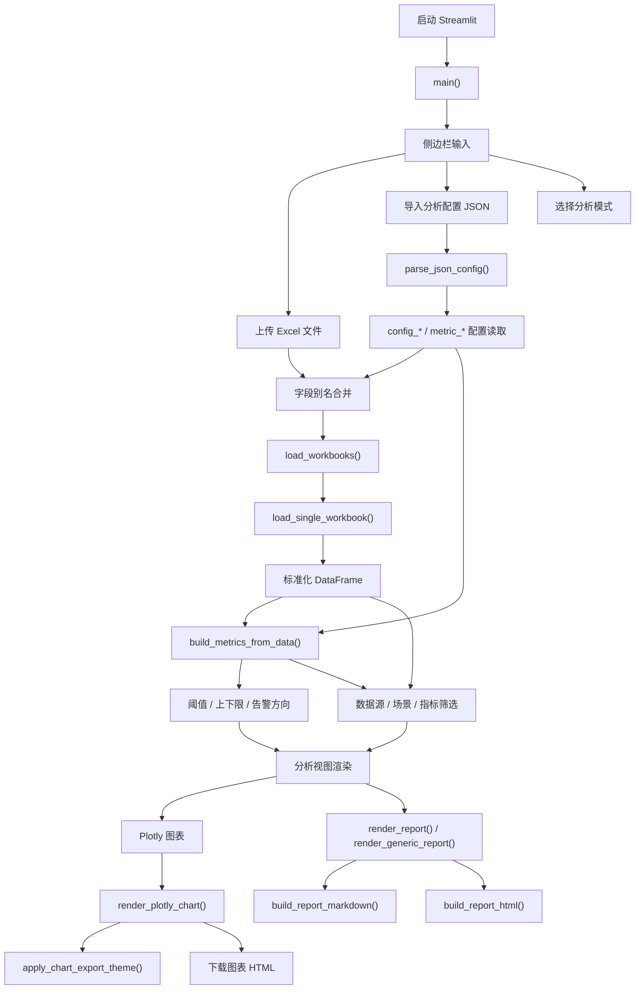
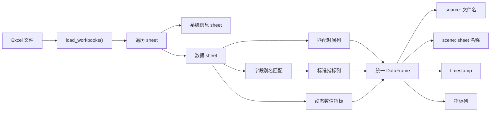
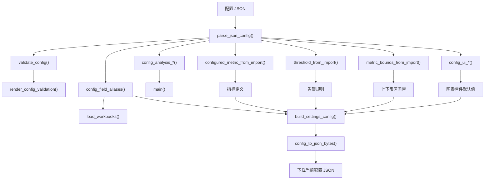
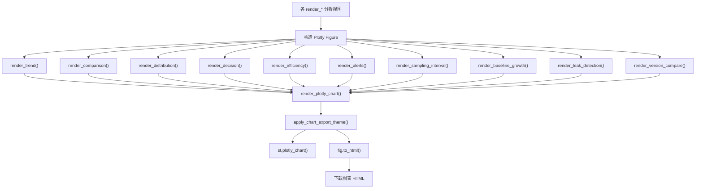
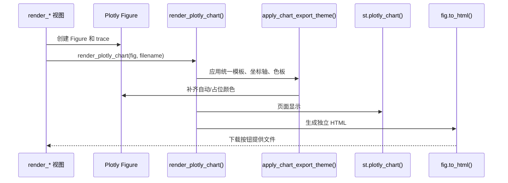
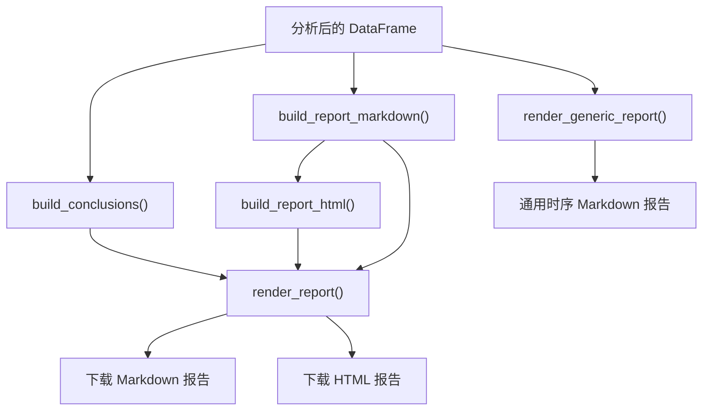
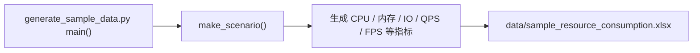

# 代码地图

本文档基于 CodeGraph 对当前代码结构的索引结果整理，用于快速理解 `perf-analyzer` 的入口、数据流、配置流和图表渲染链路。

## 总览

当前项目主要由两个 Python 文件组成：

- `app.py`：Streamlit 应用主体，包含数据导入、字段映射、指标识别、分析计算、图表渲染、配置导入导出和报告导出。
- `generate_sample_data.py`：生成应用性能模式的示例 Excel 数据。

核心架构特点：

- 单入口：`main()` 负责页面编排和侧边栏配置。
- 单数据模型：上传的多个 Excel 会统一转换为包含 `source`、`scene`、`timestamp` 和指标列的 DataFrame。
- 双模式：`应用性能` 和 `通用时序` 共用大部分分析与图表能力。
- 统一图表出口：所有 Plotly 图表通过 `render_plotly_chart()` 显示并导出 HTML。
- 配置可持久化：字段映射、阈值、指标方向、上下限区间、分析参数和部分 UI 状态可导入导出。

## 应用主流程

## 数据处理链路

关键点：

- `source` 来自上传文件名，用于多版本或多批次对比。
- `scene` 来自 Excel sheet 名称，用于场景、设备、工况或实验组分组。
- 字段映射优先使用导入配置，其次使用内置别名。
- 通用时序模式下，会尽量把非元数据的数值列识别为动态指标。

## 配置导入导出链路

配置主要覆盖范围：

- `fields`：字段别名映射。
- `analysis`：分析模式、分组名称、内存泄漏斜率阈值、预热过滤时间。
- `metrics`：指标展示名、单位、阈值、方向、上下限。
- `ui`：趋势、告警、版本对比、容量、分布、采样间隔等图表控件状态。

## 图表渲染链路

图表出口统一在 `render_plotly_chart()`，因此图表主题、导出 HTML、下载按钮等共性问题应优先在这里处理。

## 主要分析视图

| 函数 | 位置 | 作用 |
|---|---:|---|
| `render_system_info()` | `app.py:2073` | 展示系统信息 sheet |
| `render_overview()` | `app.py:2081` | 汇总场景数、样本数、峰值、告警点和摘要表 |
| `render_trend()` | `app.py:2130` | 时间趋势、滚动均值、阈值线、上下限区间带 |
| `render_comparison()` | `app.py:2243` | 场景间统计口径对比 |
| `render_distribution()` | `app.py:2292` | 箱线图和指标相关性热力图 |
| `render_efficiency()` | `app.py:2416` | 资源效率和吞吐资源散点 |
| `render_decision()` | `app.py:2494` | 风险矩阵、风险雷达图和结论辅助 |
| `render_alerts()` | `app.py:2688` | 异常时间轴、异常段持续时长和多指标联动 |
| `render_sampling_interval()` | `app.py:2908` | 采样间隔分布和时间线 |
| `render_baseline_growth()` | `app.py:2986` | 基准场景相对增长率 |
| `render_leak_detection()` | `app.py:3075` | 内存线性增长斜率判断 |
| `render_version_compare()` | `app.py:3105` | 多数据源版本对比和退化热力图 |
| `render_configuration_recommendation()` | `app.py:3225` | CPU、内存、磁盘等配置建议 |
| `render_report()` | `app.py:3318` | 应用性能模式报告导出 |
| `render_generic_report()` | `app.py:3349` | 通用时序模式报告导出 |

## HTML 图表导出细节

注意：

- App 内显示可能受到 Streamlit 前端主题影响。
- 独立 HTML 只能使用 Plotly Figure 自身携带的样式。
- 因此颜色、模板、坐标轴样式必须在 `fig.to_html()` 前写入 Figure。

## 报告导出链路

报告导出和图表 HTML 导出是两条链路：

- 报告 HTML：由 Markdown 文本转换，偏结论和表格。
- 图表 HTML：由 Plotly Figure 导出，保留交互能力。

## 示例数据生成

`generate_sample_data.py` 主要用于应用性能模式验证。通用时序模式的样例数据位于 `data/generic_timeseries_samples/`，由仓库中现有样例文件提供。

## 维护建议

- 新增图表时，优先新增 `render_*()` 函数，并通过 `render_plotly_chart()` 统一显示和导出。
- 新增配置项时，同步考虑 `parse_json_config()`、`validate_config()`、`config_ui_*()`、`build_settings_config()` 和示例 JSON。
- 新增指标识别规则时，优先扩展字段别名和 `Metric` 定义，避免在渲染函数里硬编码列名。
- 如果拆分模块，建议按 `io/config/metrics/analysis/charts/report` 六个方向切分，降低 `app.py` 的单文件复杂度。
