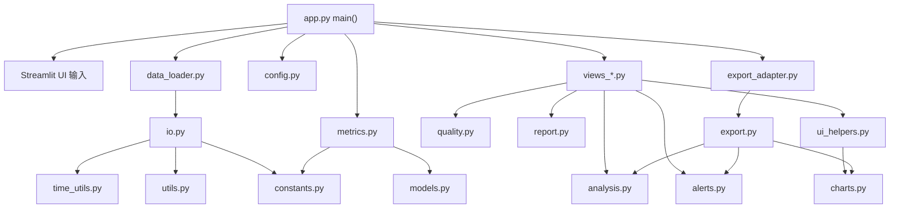
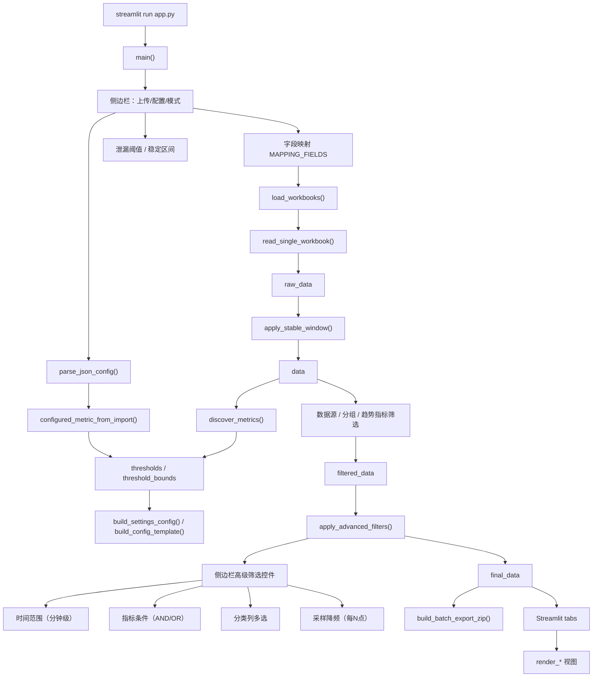
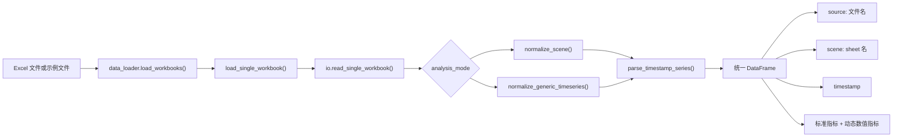
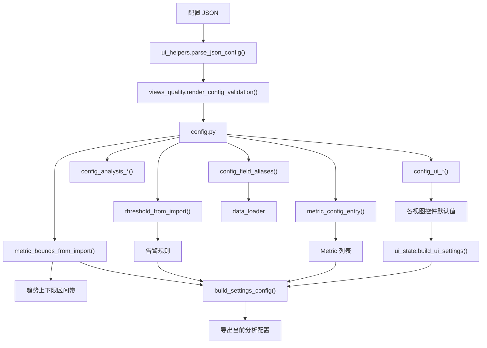
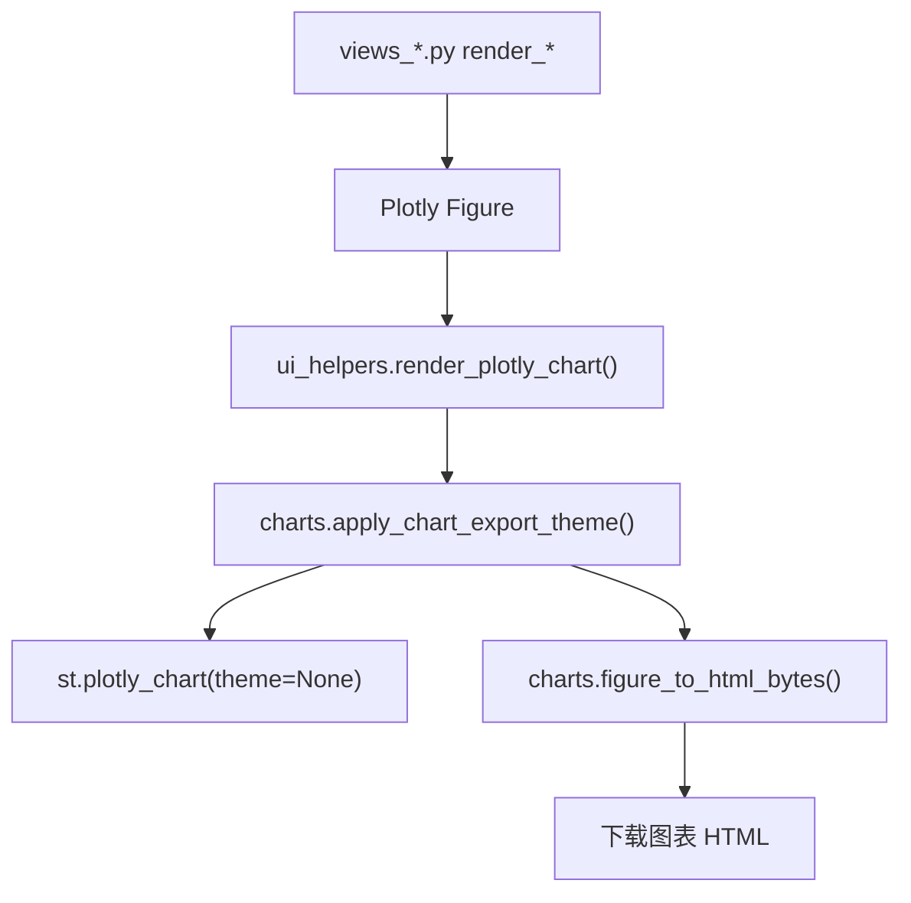
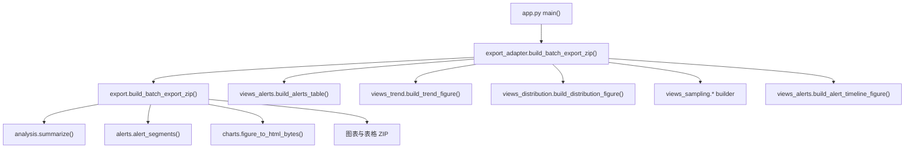
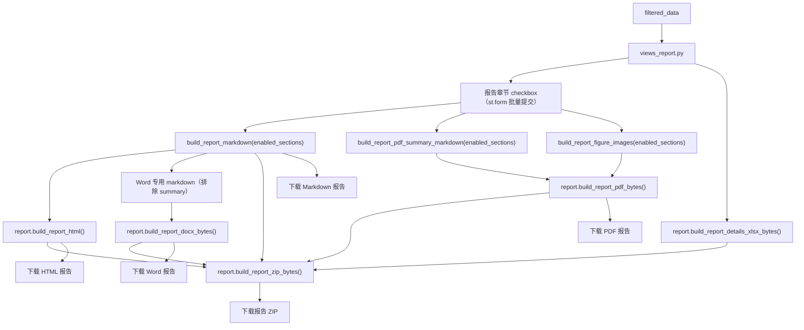
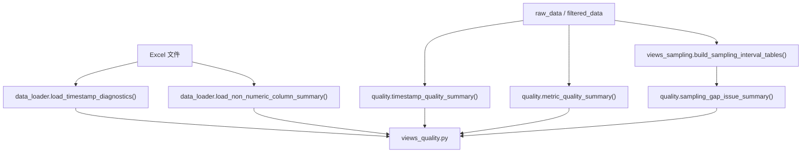
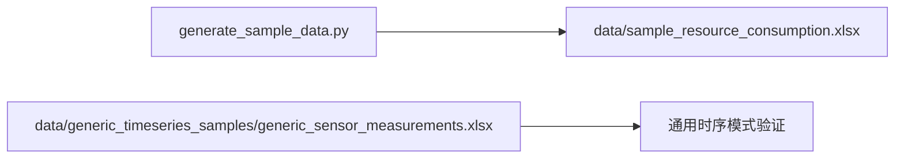

# 代码地图

本文档记录 `perf-analyzer` 当前模块化后的代码结构，用于快速理解入口、数据流、配置流、视图层和导出链路。

## 总览

当前项目已经从单体 `app.py` 拆分为 Streamlit 入口、数据处理、分析计算、视图渲染和导出适配等模块。

核心入口：

- `app.py`：Streamlit 页面编排入口。当前只保留 `main()`，负责侧边栏输入、数据加载、筛选、配置导出、批量导出和 tab 编排。
- `generate_sample_data.py`：生成应用性能模式示例 Excel。

核心包：

- `perf_analyzer/constants.py`：模式、字段映射、标准指标、图表主题常量。
- `perf_analyzer/models.py`：`Metric` 指标模型。
- `perf_analyzer/data_loader.py`：Streamlit 缓存的数据加载包装。
- `perf_analyzer/io.py`：Excel 读取、字段识别、时间戳解析、通用时序归一化。
- `perf_analyzer/metrics.py`：指标发现和指标查找。
- `perf_analyzer/config.py`：配置导入、校验、阈值、UI 默认值、配置导出 JSON。
- `perf_analyzer/analysis.py`：汇总、趋势、泄漏、效率、风险、容量、版本退化、配置建议等计算；决策 bundle 一次算齐。
- `perf_analyzer/rules.py`：`RiskRules` 决策规则（风险评分/瓶颈/雷达阈值），支持配置导入导出。
- `perf_analyzer/significance.py`：Mann-Whitney U、Cohen's d、bootstrap CI，版本对比显著性检验（纯 numpy）。
- `perf_analyzer/phases.py`：预热/稳定/压力阶段自动切分与趋势叠加。
- `perf_analyzer/alerts.py`：阈值判断、异常段、异常格式化。
- `perf_analyzer/quality.py`：时间、指标、采样间隔质量摘要。
- `perf_analyzer/report.py`：Markdown/HTML 报告内容生成。
- `perf_analyzer/charts.py`：Plotly 导出主题和 HTML 转换。
- `perf_analyzer/export.py`：ZIP 批量导出的核心实现。
- `perf_analyzer/export_adapter.py`：把各视图的图表 builder 注入 `export.py`。
- `perf_analyzer/ui_helpers.py`：Streamlit 通用 UI helper、图表统一渲染出口、配置文件读取。
- `perf_analyzer/ui_state.py`：当前 UI 控件状态快照，用于导出配置。
- `perf_analyzer/views_*.py`：各分析页面和图表 builder。

## 顶层架构

## 应用主流程

## 数据处理链路

关键约定：

- 第一个 sheet 是元信息，其余 sheet 是场景、设备、工况、批次或实验组。
- `source` 来自文件名，多文件上传时用于版本或批次对比。
- `scene` 来自 sheet 名。
- 应用性能模式优先识别标准性能指标。
- 通用时序模式会把非元数据的数值列作为动态指标。
- 毫秒级时间戳在 `time_utils.parse_timestamp_series()` 中统一解析。

## 配置链路

配置覆盖范围：

- `fields`：字段别名映射。
- `analysis`：分析模式、分组名称、内存泄漏斜率阈值、稳定区间。
- `metrics`：指标名称、单位、阈值、告警方向、上下限。
- `ui`：趋势、异常、版本对比、容量、分布、采样间隔、决策等控件状态。

## 视图模块

| 模块 | 主要函数 | 职责 |
|---|---|---|
| `views_overview.py` | `render_overview()` | 场景数、样本数、峰值、告警点、摘要表、告警持续性摘要 |
| `views_trend.py` | `render_trend()` / `build_trend_figure()` | 时间趋势、阈值线、滚动均值、上下限区间带 |
| `views_distribution.py` | `render_comparison()` / `render_distribution()` | 场景对比、箱线图、相关性热力图、控制图 |
| `views_alerts.py` | `render_alerts()` / `build_alerts_table()` | 异常点、异常时间轴、异常段、异常段多指标联动 |
| `views_sampling.py` | `render_sampling_interval()` | 采样间隔表、采样间隔箱线图、采样间隔时间线 |
| `views_baseline.py` | `render_baseline_growth()` / `render_leak_detection()` / `render_version_compare()` | 基准增长、泄漏趋势、多文件版本对比 |
| `views_decision.py` | `render_efficiency()` / `render_decision()` | 资源效率、吞吐散点、风险矩阵、风险雷达图、发布门禁、容量估算 |
| `views_quality.py` | `render_timestamp_diagnostics()` / `render_data_quality()` | 时间字段诊断、时间质量、指标质量、采样突变、非数值列 |
| `views_report.py` | `render_configuration_recommendation()` / `render_report()` / `render_generic_report()` | 配置建议、应用性能报告、通用时序报告 |

## 图表渲染链路

约定：

- 页面展示和 HTML 导出统一走 `render_plotly_chart()`。
- 图表色板和主题在 `charts.apply_chart_export_theme()` 中补齐。
- 导出 HTML 使用 Figure 自身样式，不依赖 Streamlit 前端主题。

## 批量导出链路

设计意图：

- `export.py` 只关心 ZIP 结构和导出流程。
- `export_adapter.py` 负责把视图层的 Figure builder 注入导出核心。
- 这样可以避免 `app.py` 直接依赖所有图表 builder。

## 报告导出链路

报告导出和图表导出是两条链路：

- 报告 HTML：由 Markdown 文本转换，偏结论和表格。
- 报告 PDF：由 PDF 专用摘要 Markdown 和 Matplotlib 静态 PNG 图转换，只保留结论、Top 风险、关键表格和关键图表。
- 明细 Excel：ZIP 内包含完整分析表，适合筛选、排序和复核。
- 图表 HTML：由 Plotly Figure 导出，保留交互能力。

## 质量诊断链路

## 主要计算模块

| 模块 | 代表函数 | 说明 |
|---|---|---|
| `analysis.py` | `summarize()` / `_compute_metric_stats()` | 按数据源和场景汇总各指标统计、超阈、趋势 |
| `analysis.py` | `apply_stable_window()` | 按数据源和场景排除前 N 分钟预热数据 |
| `analysis.py` | `apply_advanced_filters()` | 时间范围、指标条件、分类列、降采样四维高级筛选 |
| `analysis.py` | `leak_analysis()` / `trend_analysis()` | 线性趋势和疑似泄漏筛查 |
| `analysis.py` | `resource_efficiency_analysis()` | 资源消耗归一化到吞吐或并发 |
| `analysis.py` | `scene_decision_analysis()` / `release_gate_analysis()` | 风险评级和发布门禁（阈值来自 `RiskRules`） |
| `analysis.py` | `compute_decision_bundle()` | 单次计算决策页全部表格（决策/稳定性/瓶颈/矩阵/雷达） |
| `analysis.py` | `workload_efficiency_buckets()` | 按分钟分桶计算瞬时资源成本 |
| `analysis.py` | `capacity_estimation()` / `configuration_recommendation()` | 容量曲线和配置建议 |
| `alerts.py` | `metric_alert_mask()` / `alert_segments()` | 指标异常点和连续异常段 |
| `alerts.py` | `max_continuous_alert_minutes()` | 最大连续超阈时长（支持预计算 mask） |
| `rules.py` | `RiskRules` / `risk_rules_from_config()` | 决策分析可配置阈值集 |
| `significance.py` | `significance_test()` / `mann_whitney_u()` / `cohens_d()` | 版本对比统计显著性 |
| `phases.py` | `detect_phases()` / `phase_overlay_figure()` | 阶段切分与趋势叠加 |
| `quality.py` | `timestamp_quality_summary()` / `metric_quality_summary()` | 时间与指标质量诊断 |
| `metrics.py` | `discover_metrics()` / `metric_by_key()` | 标准指标和动态指标发现 |

## 示例数据

## 维护建议

- 新增页面：优先在 `perf_analyzer/views_*.py` 中新增 `render_*()`，由 `app.py main()` 编排到 tab。
- 新增图表：统一通过 `ui_helpers.render_plotly_chart()` 展示和导出。
- 新增可批量导出的图表：在对应 `views_*.py` 提供 Figure builder，再通过 `export_adapter.py` 注入 `export.py`。
- 新增指标：优先扩展 `constants.py` 的标准指标和字段别名，动态指标规则放在 `metrics.py` / `utils.py`。
- 新增配置项：同步更新 `config.py`、`ui_state.py`、示例 JSON 和 README。
- 新增筛选维度：在 `analysis.py` 的 `apply_advanced_filters()` 中添加新参数，同时在 `app.py` 侧边栏添加对应控件。
- 新增报告章节：在 `constants.py` 的 `REPORT_SECTIONS` / `REPORT_SECTIONS_GENERIC` 中添加条目，在 `report.py` 对应 `build_*` 函数中添加渲染块。
- 调整数据读取：优先修改 `io.py` 和 `time_utils.py`，不要在视图层解析原始 Excel。
- 调整分析口径：优先放入 `analysis.py`、`alerts.py` 或 `quality.py`，视图层只负责控件、展示和下载。
- 导出趋势图参数：`export.py` 中的 `build_trend_figure` 调用需与 `views_trend.py` 签名一致（目前通过 `trend_band_mode`、`trend_show_rolling` 等参数传递）。
